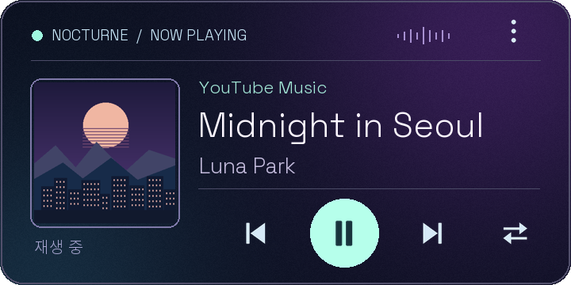

# Music Widget Runtime

원하는 디자인을 AI로 만들고 Android 홈 화면에서 사용하는 음악 위젯입니다.
Android 12 이상에서 음악 앱의 MediaSession을 통해 곡 정보와 재생 제어를 연결합니다.



## 처음 사용하는 분

1. [최신 릴리스](https://github.com/vividhyeok/music-widget-runtime/releases/latest)에서 MusicWidgetRuntime-debug.apk를 다운로드해 설치합니다. 직접 빌드하려면 아래 안내를 따릅니다.
2. 앱에서 **알림 접근 설정 열기**를 누르고 Music Widget Runtime을 허용합니다.
3. Spotify나 YouTube Music 등에서 음악을 재생합니다.
4. 홈 화면의 위젯 목록에서 Music Widget Runtime을 추가하고 테마와 플레이어를 선택합니다.
5. 다른 디자인은 [Tape Deck 테마](dist/tape-deck.mwidget)를 다운로드해 앱의 **.mwidget 가져오기**로 추가합니다.

알림 접근 메뉴와 위젯 크기 조절 범위는 기기마다 다릅니다. 위젯 본문을 누르면 선택된 음악 앱을 엽니다. 위젯 설정은 앱의 **내 위젯**에서 엽니다.

## AI에게 내 디자인 만들게 하기

[제작 키트 ZIP](dist/music-widget-ai-kit.zip)을 다운로드해 ZIP 읽기와 Python 실행을 지원하는 AI에 첨부합니다. 원하는 스타일이나 레퍼런스 이미지를 함께 전달하면 됩니다.

> 이 레퍼런스를 바탕으로 미니멀한 음악 위젯을 만들어줘. 곡 제목과 재생 버튼만 넣고 배경은 투명하게 해줘.

키트에는 프로젝트 설명, 제작 스킬, 규격, 예제 두 개, 검증 및 PNG 미리보기 도구가 들어 있습니다.
AI가 반환한 .mwidget을 휴대폰 앱에서 가져와 적용합니다. 같은 테마 ID를 가져오면 기존 테마가 교체됩니다.

APK는 테마 실행을 담당하고 .mwidget은 디자인과 선택한 기능을 담습니다. 테마 제작에 Android 빌드는 필요 없습니다.

## 지원 범위

- 곡 제목, 아티스트, 앨범, 앨범아트, 플레이어, 재생 상태
- 선택적 진행 막대, 경과 시간과 전체 길이
- 재생/일시정지, 이전/다음 곡, 플레이어 전환, 10초 앞뒤 이동, 정지
- 위젯별 테마와 플레이어 선택, 투명 배경, 가로·세로 크기 조절

기능은 테마마다 선택합니다. 정보만 표시하는 테마도 만들 수 있습니다.
음악 앱이 제공하는 동작만 실행됩니다. 진행 표시는 재생 중 약 5초 간격으로 갱신합니다.
크기 조절 시 원본 비율을 유지해 확대·축소하며 요소를 재배치하지는 않습니다.
상세 규격은 [런타임 설명](.agents/skills/music-widget-designer/references/runtime.md)에 있습니다.

## 직접 빌드하기

JDK 17 이상, Android SDK Platform 35, Python 3.10 이상이 필요합니다.
JAVA_HOME은 JDK 폴더로, ANDROID_HOME은 Android SDK 폴더로 설정합니다.

Windows PowerShell에서 실행합니다.

```powershell
./gradlew.bat assembleDebug testDebugUnitTest lintDebug
python -m pip install -r requirements.txt
python tools/test_packages.py
python tools/build_ai_kit.py
```

macOS/Linux에서는 Gradle 명령을 `bash ./gradlew assembleDebug testDebugUnitTest lintDebug`로 실행합니다.
생성된 APK는 `app/build/outputs/apk/debug/app-debug.apk`입니다.
ADB가 연결되어 있다면 `adb install -r app/build/outputs/apk/debug/app-debug.apk`로 설치할 수 있습니다.
디버그 서명은 빌드 PC마다 다를 수 있으므로 기존 설치와 서명이 다르면 업데이트 설치가 거부됩니다.

## 저장소 구성

| 경로 | 용도 |
| --- | --- |
| app/ | Android 실행기와 인앱 UI |
| themes/ | 수정 가능한 예제 테마와 에셋·라이선스 |
| dist/ | 가져오기용 테마, 미리보기, AI 제작 ZIP |
| .agents/skills/music-widget-designer/ | 제작 스킬, 규격, 패키징·검증·미리보기 |
| tools/ | 빌드 보조, 키트 생성, 테스트 |
| docs/ | AI 시작 문서, 원본 프로젝트와 라이선스 정보 |

[AI 제작 절차](docs/ai-kit-start.md)의 예제 명령은 키트 ZIP을 푼 디렉터리 기준입니다.
저장소에서는 스크립트가 .agents/skills/music-widget-designer/scripts에 있습니다.

## 검증과 개인정보

자동 테스트는 패키지 검증과 Android 렌더링·버튼 구성을 확인합니다.
Galaxy S22에 무선 ADB 업데이트 설치를 확인했으며 모든 음악 앱과 런처에서의 동작을 보장하지는 않습니다.
알림 리스너는 활성 MediaSession 조회에 사용하며 알림 내용을 저장하지 않습니다.
테마와 위젯 설정은 앱 내부에 저장됩니다.

원본 참고 범위는 [upstream 설명](docs/upstream.md), 관련 고지는 [라이선스](docs/UPSTREAM-LICENSE.txt)에 있습니다.
예제 에셋과 폰트의 조건은 각 themes 디렉터리의 LICENSE.txt를 확인하세요.
